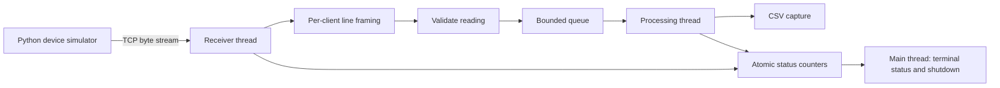
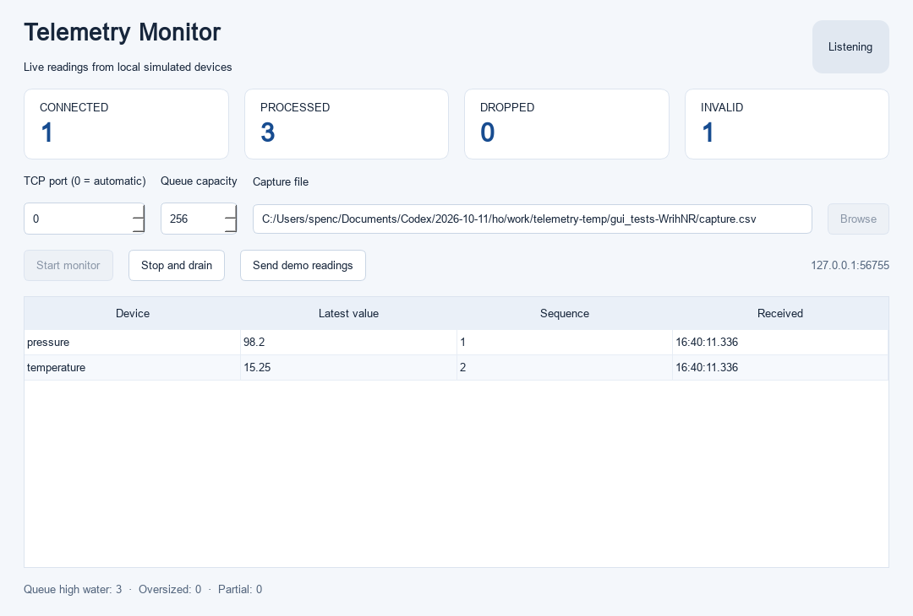

# C++ Telemetry Monitor

[](https://github.com/Spencer695/cpp-telemetry-monitor/actions/workflows/ci.yml)

A C++17 TCP server that receives **simulated device readings**, validates them, and writes a CSV capture on a separate processing thread. A bounded queue keeps memory predictable and reports dropped readings when processing cannot keep up.

This learning and portfolio project was created with AI assistance. It demonstrates networking and concurrency software; it currently uses a Python simulator and does not claim physical sensor or Thumby integration.

## What works

- Real TCP sockets on Linux and Windows, supporting up to 32 simultaneous clients.
- Message framing across split reads and multiple messages in one read.
- Strict device, sequence and numeric validation, with a 256-byte frame limit.
- Separate receiving and processing threads using a mutex and condition variable.
- Nonblocking queue insertion, explicit drop-newest overload handling, and live counters.
- CSV capture with server receive timestamps; existing log files are preserved.
- Graceful signal or timed shutdown: stop receiving, close clients, then drain the queue.
- CMake builds, core tests, socket integration tests and Linux sanitizer configurations.
- Optional Qt 6 Widgets dashboard with live readings, counters, start/stop controls and a built-in simulated-data demo.

## Architecture



The receiver owns every socket and client buffer. The processor owns the log stream. The queue protects its state with a mutex; a condition variable wakes the processor when a reading arrives or the queue closes. Counters use atomics. See [design decisions](docs/DESIGN.md) and the [learning walkthrough](docs/WALKTHROUGH.md).

## Build and test on Linux

Requirements: GCC 11+ or a recent Clang with C++17 floating-point `from_chars`, CMake 3.16+, and Python 3.9+. No pip packages or downloaded C++ libraries are needed.

```bash
cmake -S . -B build -DCMAKE_BUILD_TYPE=Debug
cmake --build build --parallel
ctest --test-dir build --output-on-failure
```

## Run a demo

In one terminal:

```bash
./build/telemetry_monitor --port 9000 --log demo.csv
```

In another, from the repository root:

```bash
python3 client/simulator.py --device simulated-sensor --count 30 --fragment
```

The server prints its listening address, then status counters each second. Press **Ctrl+C** in the server terminal to drain and stop. Open `demo.csv` to inspect the captured readings. Choose a new log filename for another run.

For an unattended run, add `--run-for-ms 5000` to stop after five seconds. `--port 0` selects an available port and prints it. To demonstrate overload, use `--queue-capacity 2 --processing-delay-ms 20` and send a large burst with `--interval 0`.

See [an actual captured demo](docs/demo-output.txt): 20 simulated readings sent with fragmented messages, logged successfully with no drops. The captured run used Windows/MSVC; Linux is verified separately by CI.

## Windows

Use a Visual Studio 2022 Developer PowerShell with the C++ build tools installed:

```powershell
cmake -S . -B build -G "Visual Studio 17 2022" -A x64
cmake --build build --config Debug
ctest --test-dir build -C Debug --output-on-failure
.\build\Debug\telemetry_monitor.exe --port 9000 --log demo.csv
python client/simulator.py --count 30 --fragment
```

Run the simulator in a separate terminal. Windows integration tests use timed shutdown because some CI subprocesses have no console; Linux tests exercise SIGTERM shutdown.

## Qt dashboard



The dashboard uses the same C++ server as the terminal application. It displays the latest value, sequence and receive time for each device, plus connected/processed/dropped/invalid counters. **Start monitor** starts a capture; **Stop and drain** finishes accepted queued readings. **Send demo readings** sends 30 synthetic readings through a real TCP connection.

On Ubuntu, install Qt with `sudo apt install qt6-base-dev libgl1-mesa-dev`, then:

```bash
cmake -S . -B build-qt -DCMAKE_BUILD_TYPE=Debug -DTELEMETRY_BUILD_GUI=ON
cmake --build build-qt --parallel
ctest --test-dir build-qt --output-on-failure
./build-qt/telemetry_gui
```

Qt 6.2+ Widgets and Network are required. Tests also use Qt Test. For Windows, supply your matching MSVC Qt SDK location:

```powershell
cmake -S . -B build-qt -G "Visual Studio 17 2022" -A x64 -DTELEMETRY_BUILD_GUI=ON -DCMAKE_PREFIX_PATH="C:/Qt/6.8.3/msvc2022_64"
cmake --build build-qt --config Release
```

Adjust the SDK path to your installation. Use Qt's `windeployqt` on the built `telemetry_gui.exe` before running it outside your Qt environment. The dashboard is optional: the normal CLI build has no Qt dependency.

All widgets are accessed on the GUI thread. A `QThread` runs the server lifecycle, its receiving/processing threads update mutex-protected snapshots, and a GUI timer refreshes the display. The table stores at most 128 device entries; all valid processed readings still go to the CSV. Closing an active window requests a drain and closes after the backend finishes. GUI tests verify real TCP updates, responsive timers, the built-in demo, restart, startup failures, bounded display and close/drain behavior.

## Wire protocol

Each ASCII message ends in a newline:

```text
simulated-sensor,0,20.000
simulated-sensor,1,20.993
```

Format: `device,sequence,value\n`. CRLF is accepted. There is no header on the wire.

| Field | Accepted values |
| --- | --- |
| Device | 1..32 ASCII letters, digits, underscores or hyphens |
| Sequence | Unsigned 64-bit integer; no whitespace or trailing text |
| Value | Finite number in [-1,000,000, 1,000,000]; decimal or scientific notation |

Exactly three fields are required. Frames can contain at most 256 bytes before the newline, including a CR if present. An oversized frame closes only that client. An incomplete final frame is discarded and counted. Idle clients close after ten seconds. Sequence values are preserved but duplicate/out-of-order values are not rejected.

## Test coverage and sanitizers

`core_tests` checks protocol boundaries, split/coalesced framing, size limits, queue overflow, drain/close behavior, consumer wakeup, and exact delivery of 8,000 records from four producers. `tests/integration.py` exercises the executable through real loopback TCP connections: reconnection, invalid and partial messages, oversize isolation, simultaneous clients, queue overload, shutdown, CLI validation and existing-log preservation.

```bash
cmake -S . -B build-asan -DCMAKE_BUILD_TYPE=Debug -DTELEMETRY_SANITIZER=address
cmake --build build-asan --parallel
ctest --test-dir build-asan --output-on-failure

cmake -S . -B build-tsan -DCMAKE_BUILD_TYPE=Debug -DTELEMETRY_SANITIZER=thread
cmake --build build-tsan --parallel
ctest --test-dir build-tsan --output-on-failure
```

AddressSanitizer and UndefinedBehaviorSanitizer run together. ThreadSanitizer runs separately. These project sanitizer configurations target Linux GCC/Clang and are not enabled in the Windows build.

## Scope and next steps

The server binds to **127.0.0.1 only**. This is a local demonstration with no authentication, TLS, acknowledgements, retransmission, guaranteed delivery or physical hardware adapter. A successful client send does not prove a reading was logged; verify the CSV and server counters. CSV output is flushed per reading, but is not a crash-proof durable database.

Possible extensions: measure latency/throughput, add dashboard filtering and implement a documented adapter for actual hardware once its interface is verified. The separate Thumby Color team project remains in progress.

